# Jogo do Mago

Roguelike dungeon crawler em 3D e primeira pessoa, com visual de PS1 e fantasia sombria. Você é um cientista mágico: escaneia tudo o que encontra para descobrir seus aspectos, estuda na escola de magia e desce à Dungeon por um portal. Ao morrer, volta à escola com o conhecimento intacto.

"Jogo do Mago" é o nome provisório; o nome escolhido para distribuir é *Catálogo do Abismo* (decisão 7).

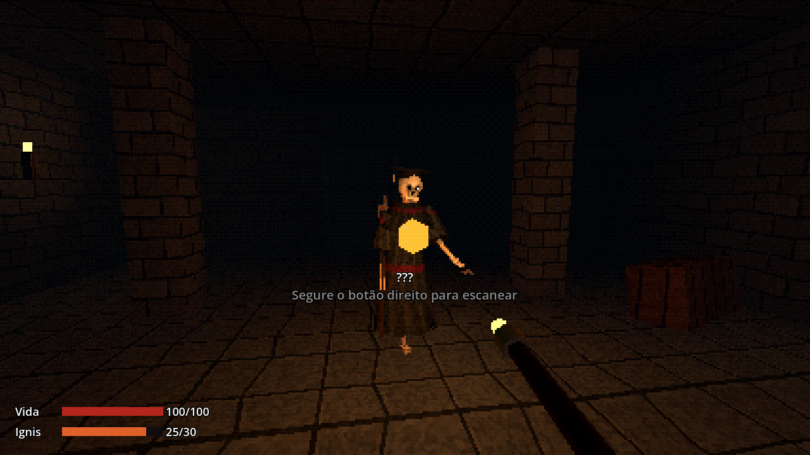

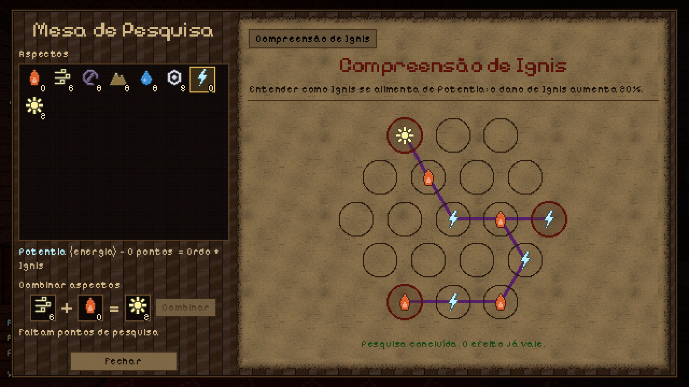

| Livro de Pesquisa | Nódulo de Vis | Conhecimento insuficiente |
| --- | --- | --- |
| 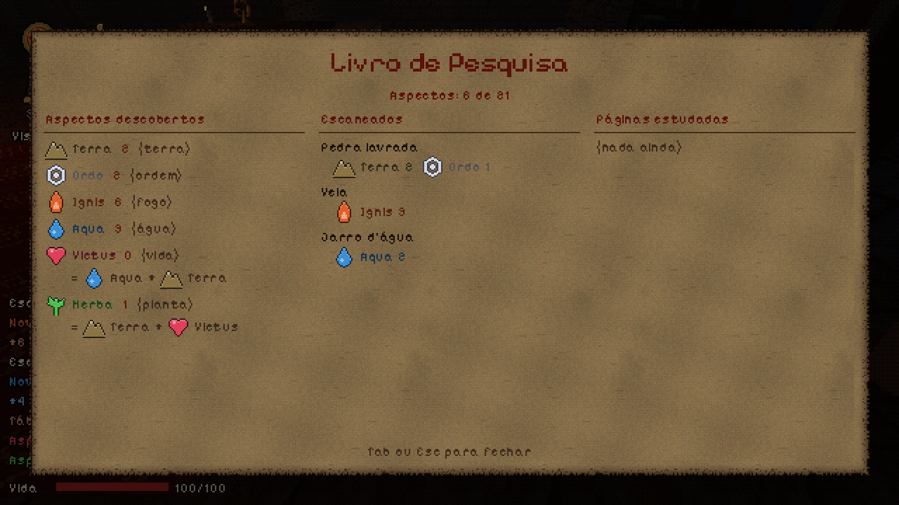 | 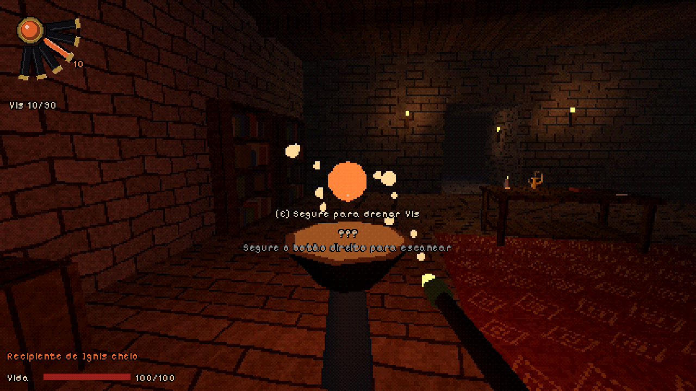 | 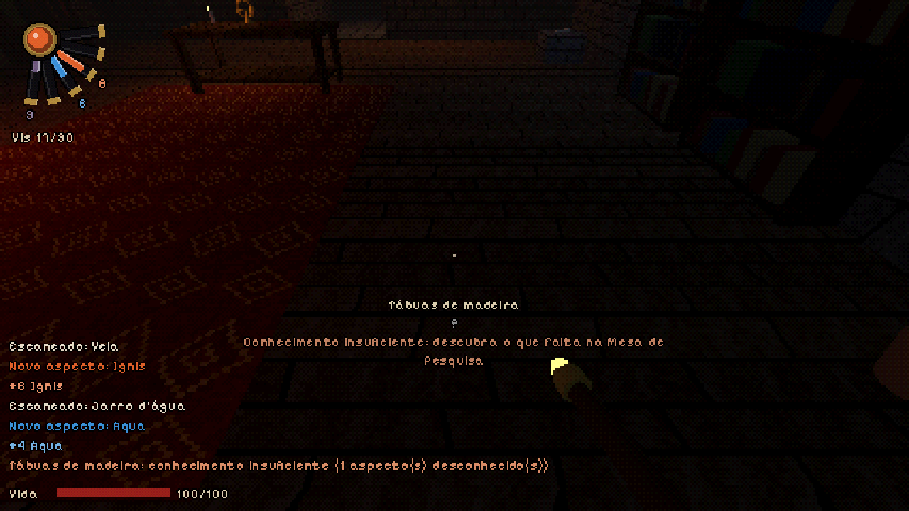 |

## Estado

**M12: acabamento.**
- **Menu inicial:** Continuar (ou Começar, sem save), **Novo jogo** (apaga o progresso, depois de confirmar), Opções e Sair.
- **Introdução:** no começo de um jogo novo, algumas linhas sobre a escola, as ruínas e o portal. Clique, E ou Esc pulam.
- **Música:** cada região tem a sua (escola, ruínas, abismo, observatório), com um controle de volume próprio nas opções.
- **Sons próprios:** cada inimigo geme, golpeia, sofre e morre do seu jeito; o gelo, o choque e a escavação também têm os seus.
- **Letras mais legíveis:** a interface passou de 10 para 11 px, tamanho em que a fonte fica nítida (em 10, o C virava O). Os algarismos agora são desenhados à mão, pixel a pixel, para o 2, o 5 e o 8 não se confundirem.

| O menu inicial | A introdução |
| --- | --- |
| 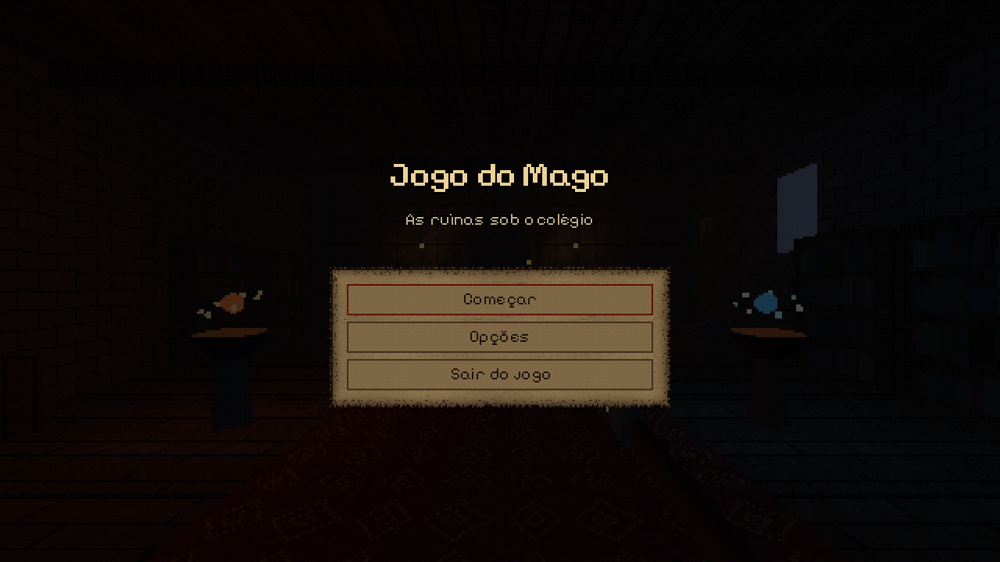 | 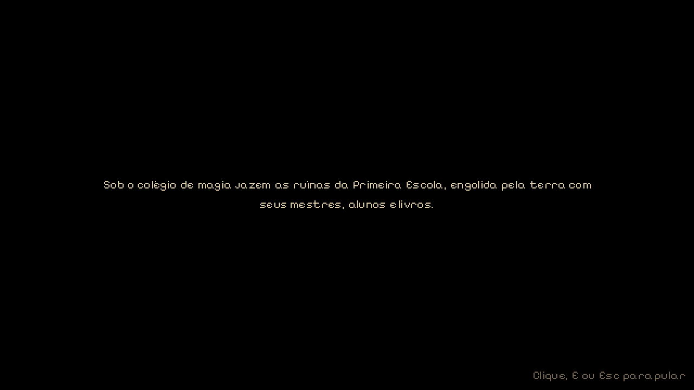 |

**M11: o segundo andar da Dungeon.** Depois que o Arquivista cai, uma grade no Grande Arquivo abre a escada para **O Observatório Afogado**: quatro salas com lunetas quebradas, mapas celestes e estrelas pintadas no teto.
- **Olho Vigia:** o primeiro inimigo que ataca de longe. Mantém distância e atira bolas de luz que dá para desviar.
- **O Olho do Fundo:** o chefe do andar. Atira em leque, se enfurece e chama dois olhos.
- **Mais coisas:** uma âncora do portal na Cisterna Estelar, fragmentos de estrela e o **Núcleo Estelar**, o maior núcleo de varinha.

| A Galeria das Lentes, com Olhos Vigias | O Olho do Fundo enfurecido |
| --- | --- |
| 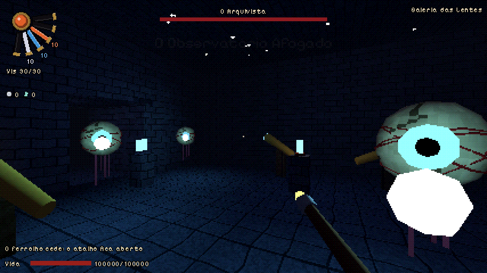 | 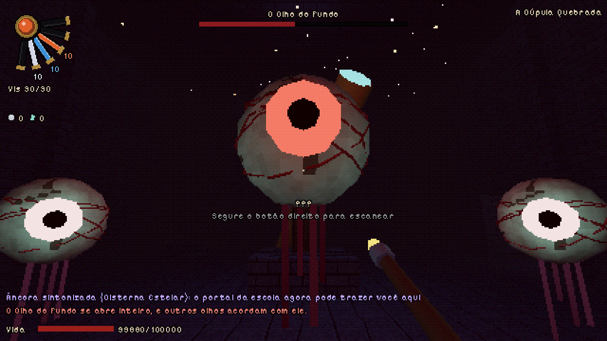 |

**M10: dois Focus novos**, liberados por páginas de pesquisa, como no Thaumcraft.
- **Focus de Choque:** gasta Aer; um raio na hora, que salta para até dois inimigos próximos.
- **Focus de Escavação:** gasta Terra; derruba **paredes rachadas** e arranca lascas dos **veios de cristal** das grutas.
- **Nódulos novos na escola:** de Aer (com Perditio), na Sala do Portal, e de Terra, no laboratório.

| O raio do Choque saltando entre bedéis | Uma parede rachada (atrás dela, o Depósito Soterrado) |
| --- | --- |
| 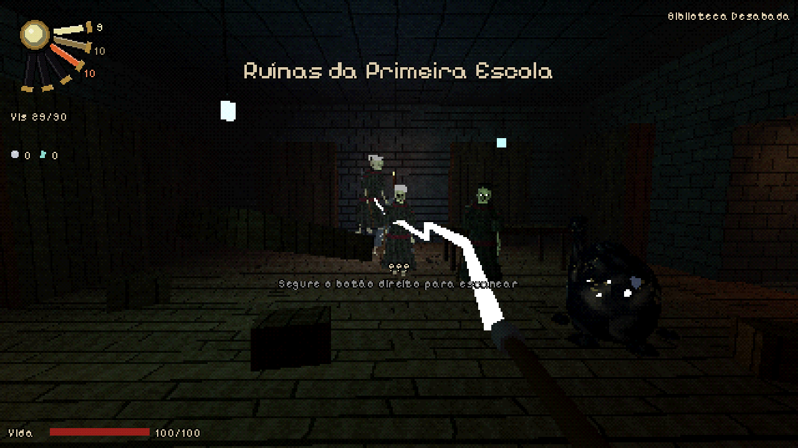 | 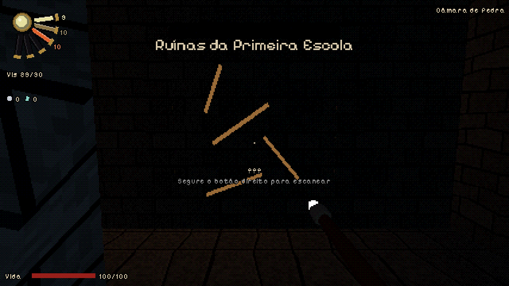 |

**M9: alquimia.** Uma porta nova, na parede leste do Salão de Estudos, leva ao **laboratório**, com o **cadinho**, como no Thaumcraft 4.
- **Dissolver:** os materiais trazidos da Dungeon viram essência dos aspectos de que são feitos.
- **Anotar:** a essência vira pontos de pesquisa, outro caminho além de escanear.
- **Preparar:** o **Elixir de Victus** cura 40 de vida (F na Dungeon). Os destilados enchem um pote vazio com 10 de Vis.
- **Ingredientes novos:** fungos luminosos, nas grutas, e tinta coagulada, que cai do Lodo de Tinta.

| O cadinho, no laboratório | A tela do cadinho |
| --- | --- |
| 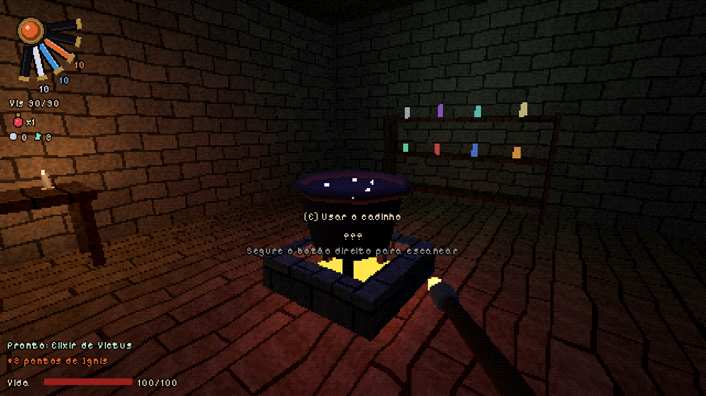 | 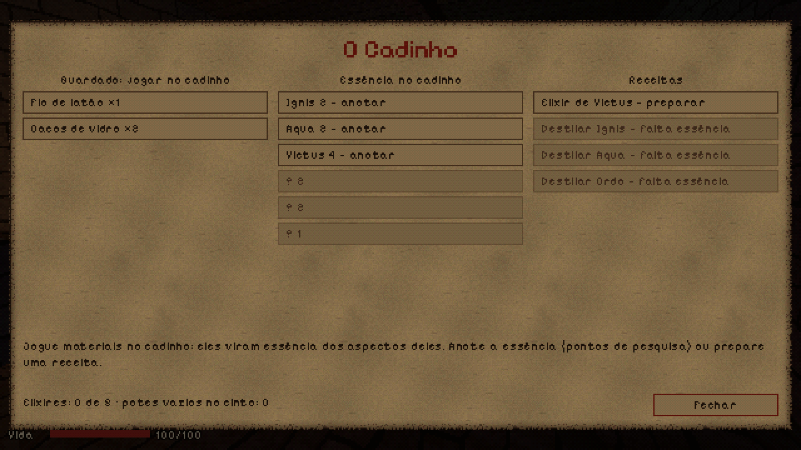 |

**M8: a varinha que cresce.** A Dungeon dá materiais, e com eles você monta varinhas melhores na **Bancada Arcana** da escola, como no Thaumcraft.
- **Núcleo** (quanto Vis cabe): madeira (10 por recipiente, 30 no total), osso (12/36) e cristal (15/45).
- **Ponteiras** (quanto as magias custam): ferro (o normal), latão (80% do Vis) e prata (dois terços).
- **Materiais:** osso antigo, lasca de cristal e fio de latão aparecem pelo mapa e caem dos inimigos; o **Selo do Arquivista** cai do chefe. Um **baú** por incursão guarda prata e materiais.
- **Pesquisa:** cada peça nova é liberada por uma página na Mesa.

| A Bancada Arcana | Montando as Ponteiras de Latão |
| --- | --- |
| 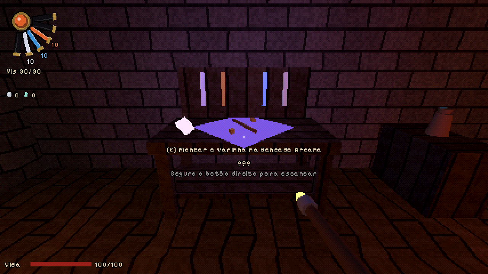 | 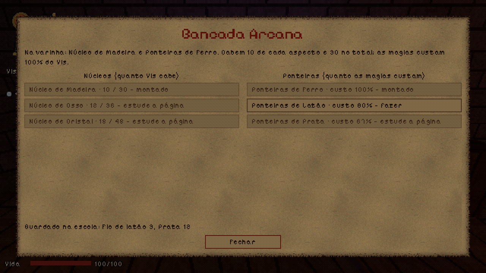 |

**Antes do M8: a Dungeon de mapa fixo, no estilo do Lunacid.**
- **Mapa feito à mão:** 15 salas interligadas, sempre as mesmas (o mapa é original; só a estrutura segue o Lunacid). O **Átrio do Poço** é o centro, e de lá saem ramos que voltam a lugares já vistos.
- **Segredos e atalhos:** grade que só abre de um lado, portão trancado com a chave achada em outro ramo, paredes falsas, um poço que cai nas grutas e uma ponte sobre um abismo.
- **Âncoras do portal:** cristais que, uma vez tocados, deixam o portal da escola levar você até eles.
- **Potes de Vis:** você começa sem nenhum. Compra com prata no **Almoxarife** ou fabrica com cacos de vidro na **bancada de vidraria**, na escola.
- **Livros perdidos:** lidos no atril da escola, cada um ensina uma receita que você ainda não tem.
- **Inimigos:** contornam obstáculos, chamam uns aos outros, batem forte e deixam prata.

| O Átrio do Poço (chegada) | A Fenda: a ponte sobre o abismo |
| --- | --- |
| 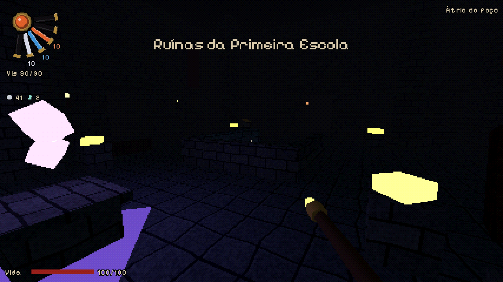 | 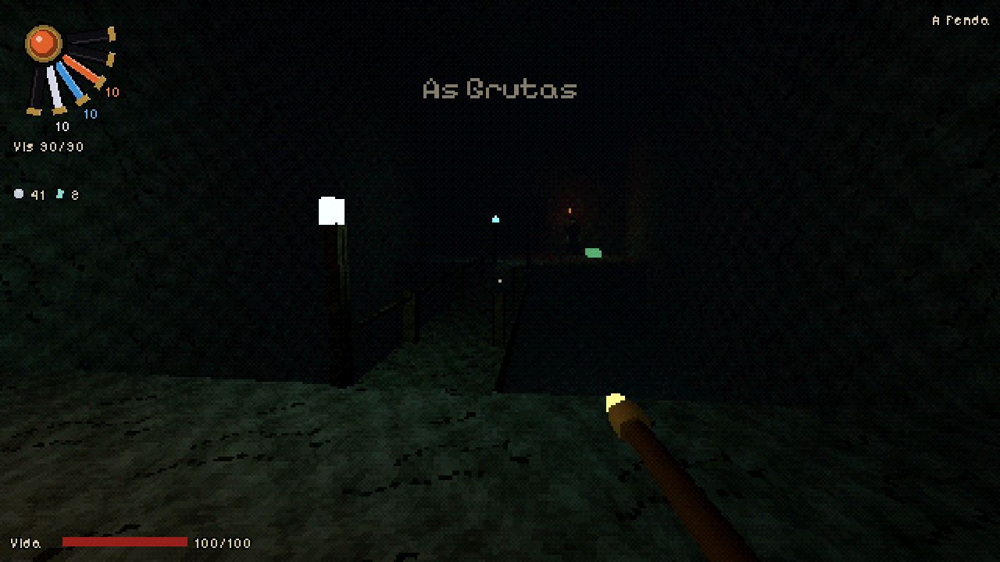 |

| O Almoxarife e a bancada de vidraria | O portal, com três âncoras sintonizadas |
| --- | --- |
| 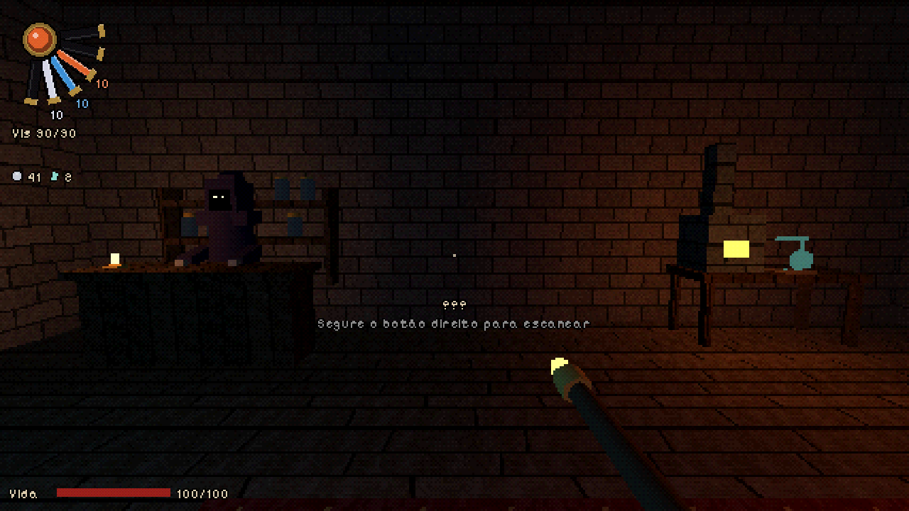 | 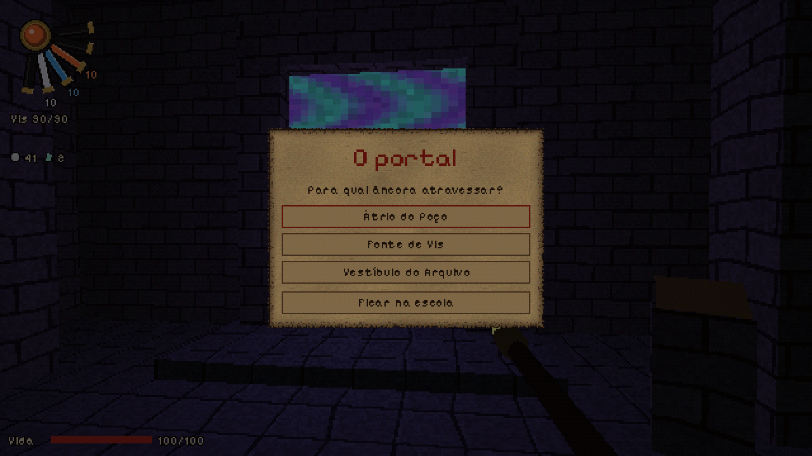 |

**M7: magia e pesquisa novas.**
- **Focus de Gelo:** liberado pela página de pesquisa *Focus de Gelum*. Gasta Aqua e Ordo e deixa o alvo lento. A tecla **Q** troca de Focus.
- **Nódulo de Aqua** na escola, que dá Aqua e Ordo.
- **Chefe:** **O Arquivista** espera no Grande Arquivo, no fundo do mapa. Na metade da vida, ele se enfurece e chama dois aprendizes.

| O Arquivista enfurecido, com os aprendizes que chamou | Nódulo de Aqua (com Ordo) e o orbe do Focus de Gelo no HUD |
| --- | --- |
| 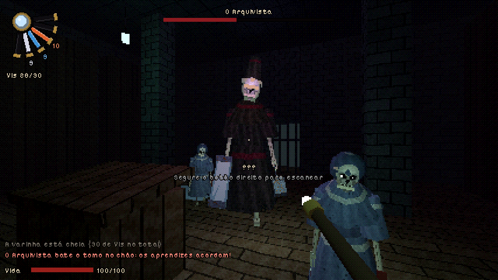 | 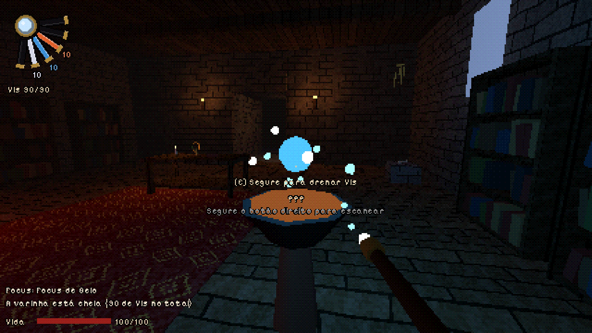 |

**M6: a Dungeon montada.** As incursões eram 5 salas sorteadas entre peças prontas (hoje as salas ficam no mapa fixo). Dois inimigos novos: o **Aprendiz Esquecido** e o **Lodo de Tinta**.

| Aprendiz Esquecido, Bedel Descarnado e Lodo de Tinta | Biblioteca desabada |
| --- | --- |
| 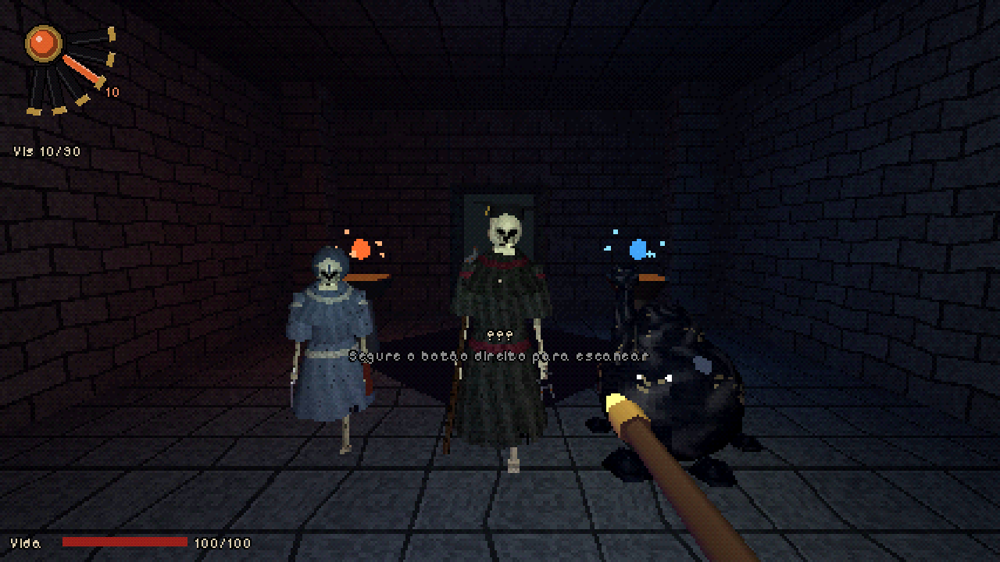 | 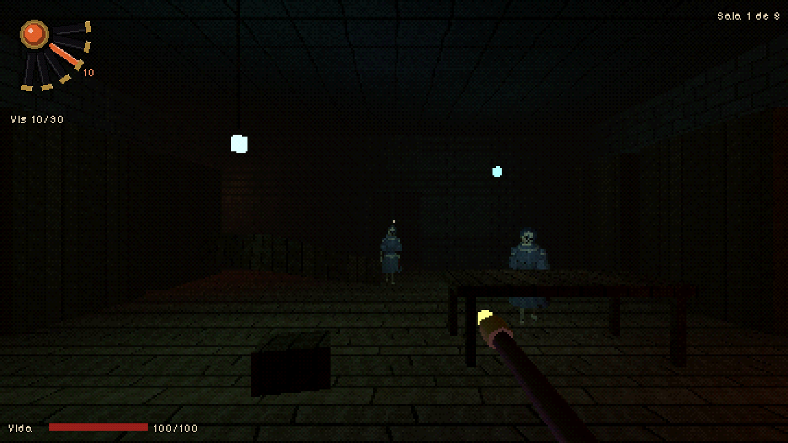 |

**Antes, no M5, o primeiro recorte ficou completo.** O ciclo inteiro funciona:

1. Na escola, você escaneia objetos, estuda e recarrega a varinha.
2. Atravessa o portal e enfrenta o Bedel Descarnado na Dungeon.
3. Vencendo, volta à escola pela saída; morrendo, desperta no Salão de Estudos sem perder o conhecimento.

Depois do M5, a pesquisa passou a seguir o Thaumcraft 4. Agora:
- Tudo é escaneável, e os aspectos compostos são descobertos na Mesa de Pesquisa, combinando os dois pais.
- O braseiro virou um Nódulo de Vis.
- O Bedel Descarnado ganhou um corpo articulado e animado.
- As páginas de pesquisa são estudadas resolvendo **notas de pesquisa**: uma grade de hexágonos no pergaminho da Mesa.
- A varinha tem um **recipiente de Vis para cada primal** (até 10 em cada) e um **limite total** (30). O HUD mostra os recipientes como frascos em volta do orbe do Focus.
- Menus e HUD são desenhados **em pixels grandes**, com a mesma redução de cores e o mesmo dithering do mundo 3D, sobre **pergaminho velho** (com moldura de madeira na Mesa). Cada aspecto tem um **ícone**.

| Documento | Conteúdo |
| --- | --- |
| [`docs/ESPECIFICACAO.md`](docs/ESPECIFICACAO.md) | especificação completa do projeto |
| [`docs/PROPOSTA-M0.md`](docs/PROPOSTA-M0.md) | tecnologia, arquitetura e decisões da seção 9 |
| [`docs/REFERENCIAS-VISUAIS.md`](docs/REFERENCIAS-VISUAIS.md) | direção de arte, paleta e inimigos (Lunacid) |
| [`docs/REFERENCIAS-THAUMCRAFT.md`](docs/REFERENCIAS-THAUMCRAFT.md) | mecânicas do Thaumcraft 3 e 4 usadas como base, e as que podem entrar depois |
| [`DECISIONS.md`](DECISIONS.md) | registro de todas as decisões |
| [`CREDITS.md`](CREDITS.md) | ferramentas e recursos de terceiros |

## Como executar

**Pelo editor** (para jogar e modificar):

1. Baixe o [Godot 4.7.2](https://godotengine.org/download/) (versão padrão, não a .NET). É um executável, sem instalação.
2. Abra o Godot, clique em **Importar** e escolha o arquivo `project.godot` desta pasta. Na primeira vez ele importa texturas, sons e textos, o que leva alguns segundos.
3. Aperte **F5**.

**Como programa:** veja [Exportar executáveis](#exportar-executáveis).

## Controles

| Tecla | Ação |
| --- | --- |
| Clique | prende o mouse na janela e começa a jogar (o jogo abre no menu inicial) |
| W A S D ou setas | andar |
| Mouse | olhar |
| Shift (segurar) | correr |
| Espaço | pular |
| Botão esquerdo (segurar e soltar) | carregar e lançar a magia de fogo |
| Botão direito (segurar) | escanear com a Lente Taxonômica |
| E | interagir (Mesa, ler, atravessar o portal, sair) |
| E (segurar) | drenar Vis do Nódulo para a varinha |
| Q | trocar de Focus (depois de liberar outro Focus por pesquisa) |
| R | despejar um pote de Vis na varinha |
| F | beber um elixir (feito no cadinho) |
| Tab | Livro de Pesquisa |
| Esc | pausa e opções; fecha qualquer tela |

## Como se joga

**Pesquisa (escola), no estilo do Thaumcraft 4:**
1. Você começa no **Salão de Estudos**. Tudo pode ser escaneado: objetos, paredes, piso, estantes, a janela, o portal, o inimigo. Mire e **segure o botão direito**: a Lente sobe e a barra enche em 1,5 s.
2. O primeiro escaneamento de cada coisa rende **pontos de pesquisa de cada aspecto** dela: 2 por unidade, então a vela (Ignis 3) rende 6 de Ignis. Escanear de novo não rende nada, mas mirar algo já escaneado mostra seus aspectos.
3. Aspectos **primais** (Ignis, Aqua, Terra, Aer, Ordo, Perditio) são descobertos escaneando. Os seis objetos iniciais da escola só têm primais.
4. Aspectos **compostos** só se descobrem na **Mesa de Pesquisa** (E), combinando os dois pais. Por exemplo, Aqua + Terra dá Victus, e cada combinação gasta 1 ponto de cada pai e rende 1 do composto. Quem tem um composto ainda desconhecido não pode ser escaneado: a Lente avisa "conhecimento insuficiente" e mostra "?" no que falta.
   - **Receitas:** para combinar, você precisa conhecer a receita do composto. As dos compostos simples, feitos de dois primais (Victus, Lux, Potentia, Motus, Vacuos, Vitreus, Gelum), já vêm sabidas.
   - **Livros:** as outras receitas vêm dos livros achados na Dungeon (item 14).
   - **Por exemplo,** para as tábuas do piso (Arbor) é preciso descobrir Victus, depois achar as receitas de Herba e de Arbor.
5. **A Mesa**, no estilo do Thaumcraft 4:
   - **À esquerda**, a grade com os aspectos que você conhece e quantos pontos tem de cada. Clique num para escolhê-lo.
   - **Combinar:** com um aspecto escolhido, clique num dos dois espaços de baixo para colocá-lo (botão direito esvazia). O terceiro espaço mostra o resultado: o ícone, ou "?" se você conhece a receita mas ainda não fez o composto. Se você não conhece receita com os dois, mostra "×": a Mesa não revela combinações por tentativa. **Combinar** gasta os pontos.
   - **À direita**, no pergaminho, a **nota de pesquisa** da página escolhida (abas no alto): uma grade de hexágonos com alguns aspectos já marcados. Escolha um aspecto e clique num círculo vazio para escrevê-lo (1 ponto dele); o botão direito apaga e devolve o ponto.
   - Dois vizinhos **se ligam** (linha roxa) quando um é parte do outro: Ignis liga com Potentia (Ordo + Ignis) e com Lux (Aer + Ignis), mas Ignis não liga com Ignis nem com Ordo. Quando todos os aspectos marcados estão ligados, a página é estudada na hora e a solução fica no pergaminho.
6. **Compreensão de Ignis** marca Ignis, Potentia e Lux: descubra Potentia e Lux na Mesa, ligue os três e o dano de fogo sobe 20%, para sempre.
7. O **Livro de Pesquisa** (Tab) lista aspectos (com ícone, pontos e receita), as **receitas que você conhece mas ainda não fez**, alvos escaneados, páginas estudadas e livros lidos.

**Magia:**
8. Segure o botão esquerdo por 0,6 s (a ponta da varinha acende e treme) e solte para lançar a magia do Focus encaixado. Soltar antes cancela sem gastar nada.
   - **Focus de Fogo** (o inicial): bola de fogo, 15 de dano, 1 de Ignis por disparo.
   - **Focus de Gelo:** é liberado ao estudar a página *Focus de Gelum*, que liga Gelum, Aqua e Vacuos. Lança um projétil de gelo com 11 de dano, gasta 1 de Aqua e 1 de Ordo e deixa o alvo a 45% da velocidade por 3 s (andar e preparar o golpe).
   - **Focus de Choque:** liberado pela página *Focus de Aer* (Aer, Motus, Potentia). Um raio sai na hora (até 16 m), com 10 de dano, gastando 1 de Aer. Se acertar um inimigo, salta para o inimigo mais próximo a até 5 m, e dali para mais um; cada salto causa 70% do dano do anterior. O Lodo de Tinta leva 50% a mais.
   - **Focus de Escavação:** liberado pela página *Focus de Escavação* (Terra, Vitreus, Perditio). Um projétil de terra com 8 de dano (o Bedel leva 50% a mais) que gasta 1 de Terra e:
     - derruba as **paredes rachadas** (as rachaduras brilham fraco; a Lente as mostra). A da câmara de pedra esconde o **Depósito Soterrado**. Derrubada, fica aberta para sempre;
     - arranca as lascas dos **veios de cristal** das grutas (gruta dos fungos, lago, gruta escondida e fundo da Fenda). As lascas caem no chão para pegar, e os veios voltam a cada incursão.
   - **Q** troca de Focus em qualquer lugar. O orbe do HUD e a ponta da varinha mudam de cor.
9. **Vis na varinha:** um recipiente para cada primal (Aer, Terra, Ignis, Aqua, Ordo, Perditio). Com o núcleo inicial, cada um guarda até 10, e no máximo 30 somando todos. Por exemplo: 10 de Ignis, 10 de Aqua e 10 de Perditio enchem a varinha. Núcleos melhores guardam mais (item 18).
   - No HUD (canto de cima), cada recipiente é um frasco em volta do orbe do Focus, com o número ao lado; embaixo, o total.
   - A varinha começa cada incursão com 10 de Ignis, 10 de Aqua e 10 de Ordo: 10 disparos de fogo e 10 de gelo.
   - No Salão há dois **Nódulos de Vis**: segure E e o Vis voa até a varinha. O laranja enche Ignis; o azul enche Aqua e Ordo (as bolinhas brancas). Cada um enche até 10 por recipiente ou até a varinha toda chegar a 30.
   - Mais dois Nódulos: o de **Aer** (com Perditio), na Sala do Portal, e o de **Terra**, no laboratório. Como o total da varinha é limitado, escolher o Vis que você leva é escolher os Focus que vai usar.
   - Na Dungeon, só a fonte de Vis recarrega, e os Nódulos dela se esgotam.
10. A Lente e a varinha não funcionam ao mesmo tempo: ou você estuda, ou você ataca.

**Dungeon:**
11. O corredor ao norte leva à **Sala do Portal**. A placa de bronze (E) conta por que a escola e o portal existem.
12. O **portal** (E) começa uma **incursão** no **mapa da Dungeon**: sempre as mesmas salas, ligadas por corredores, rampas e escadarias. Mudam a cada incursão os inimigos e os achados. Não há mapa na tela: o canto de cima à direita mostra o nome da sala.
   - **Ruínas da Primeira Escola:** o **Átrio do Poço** (chegada) fica no centro.
     - Ao norte, a biblioteca desabada; a leste, o dormitório alagado. Os dois se ligam pela galeria do ossuário, num laço de volta ao átrio.
     - A oeste, a câmara de pedra e a **Escadaria**, que desce às grutas.
     - No fim do ramo leste fica a **Cripta dos Bedéis**, com uma chave no altar.
   - **As Grutas:** a gruta dos fungos, no pé da escadaria; o **lago subterrâneo**, embaixo do poço do átrio; a **Fonte de Vis**; e **A Fenda**.
     - A Fenda é uma ponte estreita sobre um abismo. Quem cai acha um túnel no fundo, que volta à gruta dos fungos.
   - **O Avesso:** depois do **portão selado**, na outra borda da Fenda: o salão invertido, o Vestíbulo do Arquivo e o **Grande Arquivo**, onde o chefe espera.
   - **O Observatório Afogado** (segundo andar): a grade a leste do Grande Arquivo só cede depois que o Arquivista cai.
     - A escada desce à **Galeria das Lentes**. Dali se vai à **Sala dos Mapas Celestes**, à **Cisterna Estelar** (descanso: Nódulos pequenos e uma âncora do portal) e à **Cúpula Quebrada**, onde espera o **Olho do Fundo**.
     - Vencê-lo abre a passagem de volta à escola, ao sul da cúpula.
     - Uma parede rachada liga a galeria direto à cúpula, um atalho para quem tem a Escavação.
   - **Peças do mapa** (abertas uma vez, ficam assim para sempre):
     - **Atalho:** a grade entre o dormitório e o átrio só abre do lado do dormitório. Dê a volta pela biblioteca e pelo ossuário para abri-la.
     - **Portão selado:** abre com a **Chave da Cripta**.
     - **Paredes falsas:** duas paredes somem ao toque (E) ou com uma magia, e escondem tesouros. Elas não mostram texto, mas a Lente as revela como "parede ilusória".
     - **O poço:** pule pelo parapeito quebrado do átrio para cair direto no lago das grutas. É só de ida.
   - **Âncoras do portal:** cristais roxos no átrio, na Fonte de Vis e no Vestíbulo do Arquivo.
     - Toque (E) para sintonizar. Depois, a âncora leva você de volta à escola, com vida e com tudo o que achou.
     - Com mais de uma sintonizada, o portal da escola pergunta para qual atravessar.
   - Ao entrar numa região, o nome dela aparece no alto da tela, e a névoa, a luz e o som mudam aos poucos.
   - **Nódulos de Vis:** na Fonte de Vis, um de Ignis (10 de Vis) e um de Aqua com Ordo (14); no Vestíbulo, um pequeno de Ignis (8). Eles se apagam quando esgotam.
   - **Chefe:** no Grande Arquivo espera **O Arquivista**, com a barra de vida no alto da tela.
     - Alto e lento, golpeia forte com o tomo e não se abala com os disparos.
     - Na metade da vida, se enfurece: fica mais rápido e chama dois aprendizes.
     - O fogo o fere normalmente; o frio, 30% a mais.
     - Vencê-lo abre a passagem de volta à escola. Vencido, ele não volta.
13. **Potes de Vis:** você começa **sem potes**. O cinto leva até 4, de até 10 de Vis cada (um aspecto por pote). Eles aparecem embaixo do mostrador de Vis.
   - **Comprar:** o **Almoxarife**, atrás do balcão no Salão de Estudos, vende um pote por 35 de prata.
   - **Fabricar:** a **bancada de vidraria**, do outro lado do salão, faz um pote com 4 cacos de vidro, 3 de Ignis e 3 de Ordo da varinha.
   - **Prata:** os inimigos deixam prata ao cair, e há bolsas de prata pelas salas.
   - **Cacos de vidro:** aparecem em montes pelas salas e ficam de cada pote selado esvaziado.
   - **Guardar:** prata e cacos achados só ficam guardados se você voltar vivo à escola, por uma âncora ou pela saída do Arquivo. O HUD mostra quanto você tem, contando o que achou.
   - **Encher:** na escola, segure E num Nódulo com a varinha cheia; o que sobra vai para os potes.
   - **Usar:** na Dungeon, **R** despeja um pote na varinha. Ele escolhe primeiro um aspecto que o Focus encaixado gasta.
   - **Potes selados** aparecem pelas salas (E): o Vis vai para os seus potes e, depois, para a varinha.
   - **Morte:** ao morrer, o Vis dos potes se perde, mas os potes continuam com você.
14. **Livros perdidos:** cada região esconde um livro (com brilho dourado). Pegue-o com E; ele só pode ser lido no **atril** do Salão de Estudos, na escola.
   - **Receita sorteada:** o livro não tem receita fixa. Ao ser lido, ensina uma receita sorteada entre as que você **ainda não tem**, de preferência uma que você já possa fazer (com os dois pais descobertos). A receita aparece no fim do texto e fica no Livro de Pesquisa.
   - **São 13 receitas a aprender,** inclusive as dos aspectos estranhos das profundezas (Tenebrae, Limus, Vitium, Alienis), que estão nas coisas das grutas e do Avesso.
   - **Fim dos livros:** quando não há mais o que aprender, os livros deixam de aparecer.
   - **Morte:** quem morre antes de voltar à escola perde os livros que carregava.
15. **Inimigos:**

   | Inimigo | Comportamento | Fogo | Escaneável depois de descobrir |
   | --- | --- | --- | --- |
   | **Bedel Descarnado** | lento; antes de golpear, ergue o bastão com um sopro: recue para esquivar | fraco: 3 disparos, ou 2 com a página | Mortuus e Exanimis |
   | **Aprendiz Esquecido** | rápido e frágil; golpeia com a pena quase sem aviso | fraco: 2 disparos | Mortuus, Exanimis e Cognitio |
   | **Lodo de Tinta** | lento, golpe forte com o braço de tinta | resiste: 4 disparos (gelo: 2) | Cognitio |
   | **O Arquivista** (chefe) | ver acima | normal: 9 disparos | Cognitio, Exanimis, Spiritus e Mortuus |
   | **Olho Vigia** | flutua, mantém uns 4,5 m e atira de até 10 m uma bola de luz lenta (10 de dano); só atira enxergando você | fraco: 2 disparos (o Choque também) | Lux, Cognitio e Alienis |
   | **O Olho do Fundo** (chefe do segundo andar) | atira três bolas em leque; na metade da vida, fica vermelho, mais rápido e chama dois Olhos Vigias | normal: 16 disparos | Lux, Cognitio, Alienis e Praecantatio |

   - **Movimento:** os inimigos andam por uma malha de navegação gerada junto com o mapa, contornando pilares, móveis e pedras.
   - **Alerta:** quando um nota você, acorda os que estão a até 9 m, e cada magia lançada acorda os que estão a até 10 m.
   - **Dano:** batem mais forte que antes (o Bedel tira 16 de vida; o Arquivista, 28).
   - Na Dungeon há muitos objetos para escanear, com aspectos que a escola não tem.
   - **Espólio:** cada inimigo deixa um pouco de prata ao cair (o Arquivista, bastante).
   - Para repetir os mesmos inimigos e achados, rode o jogo com `--seed=N` (a semente de cada incursão aparece no terminal).
16. Voltando à escola por uma âncora ou pela saída do Arquivo, a vida é restaurada; o Vis só volta nos Nódulos.
17. Se a vida chegar a zero, você desperta no Salão de Estudos com a vida cheia e a varinha com o Vis inicial.
   - **Perde:** o Vis dos potes, os livros não lidos, a prata e os cacos achados na incursão.
   - **Continua:** o conhecimento (aspectos, pontos, escaneamentos, notas, páginas, livros lidos e receitas), o mapa (atalhos e passagens abertas, chaves, âncoras e o chefe vencido), os potes, as peças da varinha e o que já estava guardado na escola.

18. **A Bancada Arcana** (E), na parede oeste do Salão de Estudos, monta a varinha com um **núcleo** e um par de **ponteiras**:

   | Peça | O que faz | Para fazer | Página |
   | --- | --- | --- | --- |
   | Núcleo de Madeira | 10 por recipiente, 30 no total | já vem com você | — |
   | Núcleo de Osso | 12 por recipiente, 36 no total | 5 ossos antigos, 15 de prata, 5 de Ordo | *Núcleo de Osso* (Mortuus, Terra, Perditio) |
   | Núcleo de Cristal | 15 por recipiente, 45 no total | 5 lascas de cristal, 2 ossos, 30 de prata, 5 de Ordo e 5 de Aqua | *Núcleo de Cristal* (Vitreus, Praecantatio, Terra), depois da de osso |
   | Núcleo Estelar | 18 por recipiente, 54 no total | 5 fragmentos de estrela, 3 lascas de cristal, 40 de prata, 5 de Ignis e 5 de Ordo | *Núcleo Estelar* (Lux, Praecantatio, Vitreus), depois da de cristal |
   | Ponteiras de Ferro | as magias custam o normal | já vêm com você | — |
   | Ponteiras de Latão | 80% do Vis, em média: a cada cinco disparos de 1, um sai de graça | 3 fios de latão, 10 de prata, 5 de Ignis | *Ponteiras de Latão* (Ordo, Ignis, Potentia) |
   | Ponteiras de Prata | dois terços do Vis, em média | 40 de prata e o Selo do Arquivista, 5 de Ignis e 5 de Ordo | *Ponteiras de Prata* (Metallum, Lux, Praecantatio), depois da de latão |

   - **Liberar:** cada peça nova é liberada por uma página de pesquisa, resolvida na Mesa como as outras.
   - **Fazer:** gasta os materiais guardados na escola e o Vis da varinha (como a Bancada Arcana do Thaumcraft), e a peça já vai para a varinha.
   - **Montar:** trocar entre peças que você já tem é de graça, na mesma tela. A haste da varinha na mão tem a cor do núcleo; as pontas, a da ponteira.
   - **Materiais:** ossos antigos (ruínas, e caem do Bedel), fio de latão (ruínas, e cai do Aprendiz), lascas de cristal (grutas) e o **Selo do Arquivista**, que o chefe deixa ao cair e vai direto para a escola.
   - **Baú:** um por incursão, num de quatro lugares do mapa (cripta, gruta dos fungos, fundo da Fenda, salão invertido), com prata e três materiais sorteados.
   - O Livro de Pesquisa (Tab) mostra os materiais guardados e a varinha montada.

19. **O cadinho**, no laboratório (porta na parede leste do Salão de Estudos). E abre a tela, em três colunas:
   - **Guardado:** os materiais trazidos da Dungeon. Cada clique joga um no cadinho, e ele se desfaz na essência dos aspectos dele.

     | Material | Essência |
     | --- | --- |
     | Fungo luminoso (grutas) | Victus 2, Lux 1 |
     | Tinta coagulada (cai do Lodo de Tinta) | Aqua 2, Cognitio 1 |
     | Osso antigo | Mortuus 1, Terra 2 |
     | Lasca de cristal | Vitreus 2, Ordo 2 |
     | Fio de latão | Metallum 2, Ignis 2 |
     | Cacos de vidro | Vitreus 1, Ignis 1 |
     | Prata | Metallum 2 |

   - **Essência no cadinho:** fica guardada entre as incursões, e a cor do caldo segue o aspecto que mais há nele. **Anotar** transforma toda a essência de um aspecto em pontos de pesquisa (1 por 1). Aspectos que você ainda não descobriu aparecem como "?" e esperam a Mesa.
   - **Receitas:**

     | Receita | Gasta | Dá |
     | --- | --- | --- |
     | Elixir de Victus | Victus 3, Aqua 2 | um elixir: F, na Dungeon, devolve 40 de vida (até 5 elixires) |
     | Destilar Ignis, Aqua ou Ordo | 3 do aspecto | 10 de Vis num pote vazio do cinto |

   - Para preparar, você precisa ter descoberto os aspectos da receita.
   - Os elixires ficam com você mesmo se você morrer, como os potes. O HUD mostra um frasco vermelho com a quantidade ao lado dos potes.

O progresso é gravado em `user://save.json`, um JSON legível, a cada descoberta. Para começar do zero, use **Novo jogo** no menu inicial (ou apague esse arquivo). A pasta `user://` fica em:
- **Windows:** `%APPDATA%\Godot\app_userdata\Jogo do Mago`
- **Linux:** `~/.local/share/godot/app_userdata/Jogo do Mago`

## Opções

No menu inicial ou no de pausa, **Opções**:

- **Filtro visual:** *Crocante* (todos os efeitos, 240 linhas) ou *Limpo* (sem tremor, sem deformação, sem cor limitada, 480 linhas). Mexer num efeito sozinho muda o filtro para *Personalizado*.
- **Resolução interna:** altura da imagem em que o mundo é desenhado antes de ser ampliado (180, 240, 360 ou 480 linhas).
- **Efeitos**, cada um com liga/desliga: vértices trêmulos (vertex snapping), texturas deformadas (mapeamento afim), névoa, cor limitada e dithering.
- **Sensibilidade do mouse**, **volume** (geral) e **música**.

As opções ficam em `user://settings.cfg`.

| Crocante | Limpo |
| --- | --- |
| 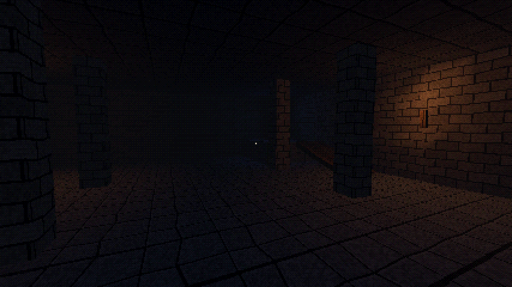 | 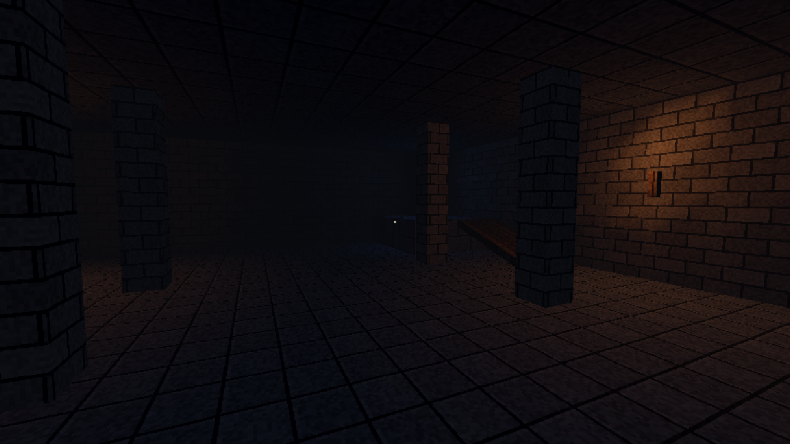 |

## Testes

A lógica do jogo (`scripts/core`) é testada com o [GUT](https://github.com/bitwes/Gut), sem abrir o jogo.

- **No editor:** painel **GUT**, na parte de baixo, botão **Run All**.
- **No terminal**, a partir desta pasta (`godot` é o caminho do executável do Godot):

  ```sh
  godot --headless --path . --import            # na primeira vez, ou depois de mudar arquivos fora do editor
  godot --headless --path . -s addons/gut/gut_cmdln.gd
  ```

**O que os testes cobrem:**
- **Pesquisa:** escaneamento bloqueado por composto desconhecido, pontos por aspecto, combinação na Mesa, notas de pesquisa (grade, ligações, escrever e apagar, nota completa), estudo de páginas, andamento do escaneamento, efeitos das páginas, economia da pesquisa (tudo pode ser escaneado com os pontos disponíveis).
- **Magia:** recipientes de Vis da varinha (limite por aspecto e total), custo, carga, intervalo e recarga da magia, eficiência da varinha, dano com páginas e fraquezas, vida, reinício da incursão.
- **Inimigo:** IA (estados, esquiva, intervalo, reação ao dano, morte).
- **Magia nova:** troca de Focus, Focus de Gelo liberado pela página, custo em Aqua e Ordo; inimigo enfurecido e inimigo que não se abala. Corrente do Choque (salta para o mais perto, sem repetir alvo, com o dano caindo a cada salto); Choque e Escavação liberados por páginas cujas notas têm solução.
- **Scripts:** todo script do jogo e das ferramentas compila.
- **Acabamento (M12):** volume da música gravado e limitado; todo inimigo tem os quatro sons próprios no banco; os sons de todo Focus existem; toda sala tem música que repete; a fonte dos algarismos tem os dez e cai na Pixelify para o resto; os textos do menu inicial e da introdução existem.
- **Segundo andar (M11):** inimigo à distância só atira enxergando o jogador (o de corpo a corpo não depende disso); o conteúdo do Observatório (Olho Vigia, chefe com leque e fúria, grade do Arquivista, âncora, livros, Núcleo Estelar).
- **Alquimia (M9):** dissolver um material vira essência dos aspectos dele (e sai do que está guardado); materiais sem aspectos não se dissolvem; gastar essência é tudo ou nada; anotar só vale para aspectos descobertos; elixires respeitam o limite e curam sem passar do máximo; cadinho e elixires no save 8; toda receita usa aspectos que algum material dá.
- **Varinha (M8):** núcleo e ponteira montam a varinha; a economia da eficiência se acumula (com 1,25, cinco disparos de 1 custam 4); trocar de peça mantém o Vis que couber; peças guardadas no save 7; páginas que liberam peças; cada núcleo guarda mais e cada ponteira gasta menos que a anterior; todo material das peças aparece no mapa, nos inimigos ou no baú; as notas das quatro páginas novas têm solução.
- **Mapa da Dungeon:** o que fica para sempre (passagens, chaves, âncoras, chefes); o mapa tem toda âncora e toda sala, uma chave para cada porta trancada e passagens sem identificador repetido; toda sala sabe o próprio `room_id`.
- **Potes, prata e livros:** o jogador começa sem potes; o cinto cresce até o limite; gastar materiais é tudo ou nada; o que é achado só fica guardado ao voltar vivo, e morrer perde os achados e o Vis dos potes, mas não os potes; save formato 6 (mapa e o que fica na escola; saves antigos carregam). Receitas necessárias para combinar (as simples já vêm sabidas); livro que ensina uma receita sorteada que o jogador não tem, de preferência uma que ele já possa fazer.
- **Sistema:** persistência (save), gerador com semente, opções.
- **Dados:** carregamento e verificação de todo o conteúdo, inclusive os valores da especificação e o balanceamento.
- **Arquitetura:** a regra de camadas e os arquivos de cena (parâmetros de shader com casa decimal).

## Ferramentas

| Comando | O que faz |
| --- | --- |
| `godot --headless --path . -s tools/balance_report.gd` | relatório de balanceamento: disparos por recipiente, acertos para derrubar cada inimigo (com e sem páginas), golpes para derrubar o jogador, pontos de pesquisa, quantos disparos cada sala e região do mapa pedem em média e quanta prata e quantos cacos uma incursão rende |
| `godot --headless --path . -s tools/generate_textures.gd` | gera de novo as texturas provisórias |
| `godot --headless --path . -s tools/generate_sounds.gd` | gera de novo os sons provisórios e as músicas |
| `godot --headless --path . -s tools/generate_digit_font.gd` | gera de novo os algarismos da interface (`assets/ui/digits_font.tres`), desenhados à mão em 5 × 7 pixels |
| `godot --headless --path . -s tools/generate_icons.gd` | gera de novo os ícones dos aspectos (`assets/icons/aspects/`) |
| `godot --headless --path . -s tools/generate_ui_theme.gd` | gera de novo o pergaminho, a moldura de madeira, os ícones dos controles, a fonte e os temas dos menus e do HUD (`assets/ui/`); rode duas vezes, com `--import` no meio, para os temas usarem as texturas novas |
| `godot --path . -- --seed=123` | escolhe a semente do gerador aleatório (impressa ao abrir o jogo) |
| `godot --path . -- --room=stone_chamber` | começa direto numa sala (`school` é o padrão; `test_room` é a sala do M1) |
| `godot --path . -- --screenshot=captura.png` | tira uma captura depois de 30 quadros e fecha |
| `godot --path . -- --no-title` | pula o menu inicial (vai direto para a sala) |

## Como o projeto está organizado

```text
data/              conteúdo do jogo, um arquivo .tres por item (editável no inspetor do Godot)
  aspects/         aspectos (primais; compostos têm dois pais)
  scannables/      objetos escaneáveis e seus aspectos
  enemies/         inimigos (também escaneáveis)
  foci/            Focus (a magia que sai da varinha)
  research/        regras de escaneamento e pontos (rules.tres) e páginas (pages/)
  books/           livros perdidos, que ensinam receitas escondidas
  player/          vida, equipamento inicial e movimento do jogador
  rooms/           salas: identificador, nome, região, cena, atmosfera e som de ambiente
  dungeon/         o mapa (rules.tres: cena do mapa e âncoras do portal; zones/: as regiões)
  economy/         preço e receita dos potes de Vis, conteúdo do baú
  items/           materiais (prata, cacos de vidro, osso, cristal, latão, o Selo do Arquivista)
  wands/           peças de varinha: núcleos (cores/) e ponteiras (caps/)
  alchemy/         receitas do cadinho (recipes/) e elixires (elixirs/)
  settings/        opções padrão e filtros visuais (presets/)
  audio/           banco de sons: qual arquivo toca em cada evento
locales/           textos: ui.csv (interface), content.csv (conteúdo), names.csv (nomes de outras obras)
scenes/            cenas: main, player, mapa da Dungeon (dungeon/), salas (rooms/), objetos (props/), inimigos, efeitos e interface (ui/)
scripts/
  core/            lógica pura, testável sem abrir o jogo: conhecimento, pesquisa, magia, combate, IA, save…
  autoload/        globais: Content (dados), Settings (opções), Game (conhecimento, incursão) e Audio (sons)
  game/            nós do mundo: jogador, Lente, varinha, projétil, inimigo, salas, mapa, corredores, grades, âncoras, portal…
  render/          shaders PS1 e a tela de baixa resolução
  ui/              HUD e telas (pausa, opções, Livro, Mesa, leitura)
assets/            texturas, materiais, sons, ícones dos aspectos (icons/), tema dos menus (ui/) e fonte (fonts/)
tests/unit/        testes do GUT
tools/             ferramentas (texturas, sons, ícones, tema, relatório de balanceamento)
addons/gut/        GUT, a ferramenta de testes
```

**Regra de camadas:** `scripts/core` só tem classes `RefCounted` e `Resource`, sem nós, cena, entrada ou tela; o teste `test_core_purity.gd` garante isso. O resto do jogo usa o núcleo e reage aos sinais dele. Todo valor e todo texto ficam em `data/`, nas cenas de sala e em `locales/`, nunca fixos no código.

## Como estender o jogo (sem mexer no motor)

Tudo abaixo é feito no editor do Godot (ou editando os arquivos de texto) e não exige programar.

**Antes de começar:**
- **Duplicar é o caminho mais curto:** no painel **Sistema de Arquivos**, clique com o botão direito num arquivo existente → **Duplicar…**, e depois edite a cópia no **Inspetor**.
- **Identificadores (`id`):** em inglês, sem espaços, únicos no tipo. Objetos e inimigos dividem o mesmo espaço de identificadores.
- **Textos novos:** acrescente uma linha `CHAVE,texto` no CSV indicado. O Godot reimporta ao salvar.
- **Para conferir:** rode os testes (painel GUT → **Run All**). O teste `test_real_content_loads_without_errors` aponta em português qualquer erro: identificador repetido, aspecto inexistente, cena faltando, valor zerado. Ao abrir o jogo, os mesmos erros aparecem no painel **Saída**.

### Adicionar um aspecto

1. Duplique `data/aspects/light.tres` como, por exemplo, `data/aspects/darkness.tres`.
2. No Inspetor, preencha:

   | Campo | Valor |
   | --- | --- |
   | `id` | `darkness` |
   | `name_key` | `ASPECT_DARKNESS` |
   | `meaning_key` | `ASPECT_DARKNESS_MEANING` |
   | `color` | a cor do aspecto |
   | `icon` | o ícone (16×16, em `assets/icons/aspects/`) |
   | `kind` | `primal` (básico) ou `compound` (composto) |
   | `parents` | os dois aspectos pais, se composto (ex.: `void` e `light`) |

3. **Ícone:** desenhe um PNG de 16×16 em `assets/icons/aspects/darkness.png` e escolha-o em `icon`. Sem desenho próprio, `tools/generate_icons.gd` gera uma bolinha na cor do aspecto (ou um símbolo, se você escrever a função `_glyph_darkness` nele).
4. Em `locales/names.csv`, acrescente o nome: `ASPECT_DARKNESS,Tenebrae`. Em `locales/content.csv`, o significado: `ASPECT_DARKNESS_MEANING,escuridão`.
5. Para que ele apareça no jogo, coloque-o nos aspectos de um objeto ou inimigo (próximas seções).
   - **Composto:** a Mesa de Pesquisa passa a oferecer a combinação dos pais sozinha. Tudo o que o contém só pode ser escaneado depois dessa descoberta.
   - **Primal:** é descoberto escaneando.
6. Rode os testes. O `test_research_economy.gd` confere se há pontos suficientes no jogo para descobrir tudo; se falhar, acrescente objetos que rendam os aspectos que faltam.

### Adicionar um objeto escaneável

1. Duplique `data/scannables/candle.tres` (ex.: `lantern.tres`). Preencha `id` (`lantern`), `name_key` (`OBJ_LANTERN`) e `aspects` (aspecto → quantidade, ex.: `light` = 2, `fire` = 1).
2. Em `locales/content.csv`: `OBJ_LANTERN,Lanterna`.
3. Para colocá-lo numa sala, duplique `scenes/props/candle.tscn` e, no nó raiz, troque `data` pelo novo `.tres`. Ajuste as malhas como quiser, mantendo uma `CollisionShape3D` (é ela que recebe a mira). Depois arraste a cena para a sala.

### Adicionar um inimigo

1. Duplique `data/enemies/bone_beadle.tres` (ex.: `ash_wraith.tres`) e preencha:

   | Grupo | Campos |
   | --- | --- |
   | Identificação | `id` (`ash_wraith`), `name_key` (`ENEMY_ASH_WRAITH`) |
   | Escaneamento | `aspects`: o que a Lente revela |
   | Combate | `max_health`, `damage`, `weaknesses` (elemento → multiplicador, ex.: `water` = 2.0) |
   | Comportamento | `move_speed`, `sight_range`, `attack_range`, `attack_windup`, `attack_cooldown`, `hurt_stun` (0 = não se abala) |
   | Chefe (opcional) | `show_health_bar`, `enrage_at` (fração da vida em que se enfurece), `enrage_speed`, `enrage_summons` (quem ele chama) e `enrage_message_key` |
   | Aparência | `scene_path` (pode ser a mesma cena do Bedel) |
   | Sons | `sound_set` (veja [Trocar textos, nomes, sons e texturas](#trocar-textos-nomes-sons-e-texturas)) |

2. Em `locales/content.csv`: `ENEMY_ASH_WRAITH,Espectro de Cinzas`.
3. Para colocá-lo numa sala, abra a cena da sala (ex.: `scenes/rooms/stone_chamber.tscn`):
   - Acrescente o novo `.tres` em `enemy_pool` de um `EnemySpawn` existente, ou adicione um `Marker3D` com o script `scripts/game/enemy_spawn.gd`. Um inimigo da lista é sorteado a cada incursão; `chance` decide se aparece alguém ali.
   - A seta azul indica para onde ele começa olhando.
   - A sala conta os inimigos sozinha: a saída só abre quando todos caem.
4. **Aparência própria (opcional):** duplique `scenes/enemies/bone_beadle.tscn` e troque as peças (malhas) e os materiais.
   - **Outro formato de corpo:** o nó `Rig` pode ter qualquer script que herde de `EnemyBody` (`scripts/game/enemy_body.gd`). O Lodo de Tinta usa `BlobRig` (`scripts/game/blob_rig.gd`).
   - **O que manter num humanoide:** o script `Enemy` na raiz e o nó `Rig` (script `EnemyRig`), com as juntas `Hips`, `Hips/ThighL/KneeL`, `Hips/ThighR/KneeR`, `Hips/Spine`, `Hips/Spine/Neck/Head` (com `Jaw` e `Eyes`) e `Hips/Spine/ShoulderL/ElbowL` e `ShoulderR/ElbowR`. As peças são filhas das juntas; a animação só gira as juntas.
   - **Ajustes no Inspetor do `Rig`:** `hunch_degrees` (corcunda), `stride_degrees` (passada), `hip_height` e `animation_fps`.
   - Aponte `scene_path` para a cópia.
5. Rode os testes e `tools/balance_report.gd`, que mostra quantos disparos o novo inimigo aguenta.

### Tornar algo escaneável

Tudo no jogo deve ter dados de escaneamento (`data/scannables/`):

| O que é | Onde ficam os dados |
| --- | --- |
| Blocos de sala (`GreyboxBlock`) | campo `scannable` |
| Objetos interagíveis (mesa, portal, placa, nódulo) | campo `scannable` do nó raiz |
| Objeto de uma peça (vela, jarro) | raiz com o script `scannable_prop.gd` (campo `data`) |
| Objeto feito de vários blocos (estante) | raiz com o script `scannable_group.gd`, deixando o `scannable` dos blocos vazio |
| Decoração fina, sem colisão própria (janela, círculo no chão) | `StaticBody3D` com `scannable_prop.gd` na **camada 2** de colisão: a mira enxerga, o jogador atravessa |

Ao escanear, a busca sobe dos blocos até o primeiro nó que tenha dados.

### Adicionar um Focus

1. Duplique `data/foci/frost_focus.tres`. Mude `id`, `name_key`, `element`, `cost` (Vis por disparo, por aspecto: ex.: `water` = 2, `order` = 1), `charge_time`, `cooldown`, `damage`, o efeito no alvo (`slow_factor` e `slow_seconds`; 1 e 0 = nenhum) e os valores do projétil (velocidade, duração, cor e força da luz). A cor da luz também pinta o projétil, o clarão, a ponta da varinha e o orbe do HUD.
2. Para o jogador ganhar o Focus, crie uma página de pesquisa com o efeito `unlock_focus` apontando para ele (veja `data/research/pages/frost_focus.tres`). Depois de estudada, a tecla Q passa a incluí-lo. O Focus inicial fica em `starting_focus`, em `data/player/player.tres`.
3. Cada aspecto de `cost` sai do recipiente dele na varinha. Só aspectos primais têm Vis, e a varinha precisa ter recipiente para eles e guardar pelo menos um disparo; os testes avisam se não guardar. Para o jogador começar com Vis desse aspecto, acrescente-o em `starting_vis` (`data/player/player.tres`).

O único `spell_type` existente é `projectile`. Um tipo novo de magia (cone, raio…) é código novo no motor.

### Adicionar um núcleo ou uma ponteira de varinha

1. Duplique `data/wands/cores/bone.tres` (núcleo) ou `data/wands/caps/brass.tres` (ponteira) e ajuste:

   | Campo | O que é |
   | --- | --- |
   | `id`, `name_key`, `description_key` | identificador, nome e descrição (em `locales/content.csv`) |
   | `tier` | ordem na Bancada Arcana |
   | `aspect_capacity`, `capacity` (núcleo) | quanto cabe em cada recipiente e somando todos |
   | `efficiency` (ponteira) | o custo das magias é dividido por ela, em média (1,25 = 80% do Vis) |
   | `cost` | materiais de `data/items/` gastos para fazer a peça |
   | `vis_cost` | Vis tirado da varinha para fazer a peça (só primais) |
   | `color` | cor da haste (núcleo) ou das pontas (ponteira) na mão |

2. Crie a página que libera a peça: duplique `data/research/pages/bone_core.tres`, troque a peça em `effects` (efeito `unlock_wand_part`), a nota (`note_aspects`, `note_radius`), os requisitos e a posição da aba (`order`).
3. **Material novo:** duplique `data/items/bone.tres` (nome, cor e `pickup_scene`, a cena do achado) e ponha lugares com `kind` igual ao `id` dele nas salas, ou dê a um inimigo (`material`, `material_chance`, `material_amount`).
4. Os testes conferem que a peça tem página, que os materiais dela aparecem em algum lugar e que a nota tem solução.

A varinha inicial fica em `data/player/player.tres`: `wand_aspects` (os recipientes, na ordem dos frascos do HUD), `starting_core` e `starting_cap`. Ali também fica `starting_vis`: o Vis com que a varinha começa cada incursão (e volta depois da morte).

### Adicionar uma página de pesquisa

1. Duplique `data/research/pages/fire_comprehension.tres`. Preencha `id`, `name_key` e `description_key`.
2. Monte a **nota de pesquisa**:
   - `note_aspects`: os aspectos já marcados na nota (pelo menos dois). Eles ficam espalhados pela borda da grade. Escolha aspectos que dê para ligar por parentesco: um primal e um composto dele ligam direto; dois primais precisam de compostos no meio.
   - `note_radius`: o tamanho da grade (1 = 7 hexágonos, 2 = 19, 3 = 37). Grade maior pede correntes mais longas, isto é, mais pontos.
   - O teste `test_research_economy.gd` resolve cada nota com os pontos do jogo e avisa se alguma for impossível.
3. Preencha os requisitos: `required_pages` (outras páginas) e `required_aspects`. É isso que forma a árvore de pesquisa.
4. Preencha `effects`. Há dois tipos:
   - `damage_multiplier`: `element` e `value` (por exemplo, 1.2 para +20%);
   - `unlock_focus`: `focus`, o Focus que a página libera.
5. Textos em `locales/content.csv`. Nos textos, `{fire}` vira o nome do aspecto. A Mesa de Pesquisa mostra a página sozinha, numa aba nova.

### Mudar o mapa da Dungeon

O mapa fica em `scenes/dungeon/dungeon.tscn`. Abra-o no editor: as salas, os corredores e as peças aparecem nos lugares deles, e dá para mover tudo com o mouse.

| Nó do mapa | O que é |
| --- | --- |
| `Rooms/` | as salas (cenas de `scenes/rooms/`), cada uma num lugar. O centro do chão fica na origem da sala |
| `Corridors/` | corredores: nós com `corridor_path.gd`. Edite `points` no inspetor: a linha do centro do chão, com trechos retos em X ou Z. Rampa: dois pontos em alturas diferentes, com o trecho pelo menos 2,2 vezes mais comprido que a diferença. Curva: um ponto no meio. `zone` dá os materiais e as luzes |
| `Passages/` | grades (`gate.gd`): `one_way` (só abre do lado da seta azul, -Z) ou `needs_key`; paredes falsas (`secret_wall.gd`); a chave (`scenes/props/old_key.tscn`, com `key_id`). Cada passagem tem um `passage_id` único, que vai para o save |
| `Anchors/` | âncoras do portal (`scenes/props/portal_anchor.tscn`), com `anchor_id`. A lista e os nomes ficam em `data/dungeon/rules.tres`; a primeira é a chegada |
| `Shaft/` | o poço do átrio ao lago |

**Adicionar uma sala:**
1. Duplique uma sala de `scenes/rooms/` (ex.: `hidden_grotto.tscn`), ou crie uma cena com raiz `Node3D` e o script `scripts/game/room.gd`.
   - O centro do chão fica na origem. As portas são aberturas de 2,4 × 2,8 m nas paredes, onde os corredores encostam.
   - Em `room_id`, ponha o `id` da sala (passo 2).

   | Elemento | Como montar |
   | --- | --- |
   | Paredes, chão, teto | nós `StaticBody3D` com o script `scripts/game/greybox_block.gd`; ajuste `size` e escolha um material de `assets/materials/`. A malha e a colisão se refazem sozinhas. Preencha `scannable`. |
   | Luzes | `OmniLight3D`; o script `flicker_light.gd` faz tremular |
   | Entrada (para testar a sala sozinha) | `Marker3D` com `entrance_point.gd` e `id` = `default` |
   | Inimigos | `Marker3D` com `enemy_spawn.gd`: `enemy_pool` (um deles é sorteado a cada incursão), `chance` (de aparecer alguém) e, para chefes, `unique_id` (vencido, não volta) |
   | Achados | `Marker3D` com `loot_spot.gd`: `kind` = `book` (lugar de livro), `jar` (pote selado), `silver` (bolsa de prata) ou `glass` (cacos), com `chance` e quantidade (`amount_min`, `amount_max`) |
   | Nódulo | instancie `scenes/props/vis_node.tscn`; ajuste `aspect`, `other_aspects`, `vis_amount` (quanto Vis tem; -1 = não acaba) e `scannable` |

2. Crie o recurso da sala: duplique `data/rooms/hidden_grotto.tres` e mude:
   - `id`, `name_key` (o nome no canto da tela, em `locales/content.csv`) e `scene_path`;
   - `zone` (`school`, `caves` ou `abyss`);
   - as medidas internas (`width`, `depth`, `height`): o mapa usa isso para saber em que sala o jogador está;
   - a atmosfera (cor e distâncias da névoa, luz ambiente), o som de `ambience` e a `music`.
3. Instancie a sala em `Rooms/` no mapa e ligue as portas com um corredor (`Corridors/`, duplique um e edite `points`).
4. **Região nova:** duplique `data/dungeon/zones/caves.tres` (nome, materiais e luzes dos corredores) e use o `id` dela nas salas.
5. **Teste direto:** `godot --path . -- --room=<id da sala>`.
   - **Os testes conferem:** que a sala está no mapa e sabe o `room_id`, e que toda porta trancada tem chave.
   - **`tools/balance_report.gd`** mostra quantos inimigos e disparos cada sala pede em média.

### Adicionar uma receita alquímica ou um ingrediente

1. **Receita:** duplique `data/alchemy/recipes/victus_elixir.tres` e ajuste `id`, `name_key`, `description_key` (o nome e a descrição podem citar aspectos, como `{life}`), `order` (a posição na tela) e `cost` (a essência gasta). O resultado é um destes:
   - **um elixir** (`elixir`): duplique `data/alchemy/elixirs/victus_elixir.tres` e ajuste `heal` (a vida que devolve) e `color` (a cor do frasco no HUD);
   - **Vis num pote vazio do cinto:** `jar_aspect` (um primal) e `jar_amount`.
2. **Ingrediente:** duplique `data/items/glow_fungus.tres`, ajuste `aspects` (a essência que ele dá no cadinho) e `pickup_scene` (a cena do achado), e ponha lugares com `kind` igual ao `id` dele nas salas, ou dê a um inimigo (`material`, `material_chance`, `material_amount`).
3. Os testes conferem que toda receita usa aspectos que algum material dá.

### Adicionar um livro

1. Duplique `data/books/wet_map.tres`.
   - Preencha `id`, `name_key`, `text_key` e `zone` (em que região ele aparece).
   - Escreva o título e o texto em `locales/content.csv`.
   - O livro não tem receita fixa: ao ser lido, ensina uma das que o jogador ainda não conhece, que aparece no fim do texto.
2. Cada região mostra um livro por incursão (um título sorteado entre os dela), num dos lugares de livro (`LootSpot` com `kind` = `book`) das salas dela, enquanto houver receitas a aprender.
3. Quais receitas já vêm sabidas: `free_recipe_tier` em `data/research/rules.tres` (1 = compostos feitos de dois primais). Um aspecto composto novo entra sozinho na lista das receitas a aprender.

### Trocar textos, nomes, sons e texturas

- **Textos:** `locales/ui.csv` (interface) e `locales/content.csv` (conteúdo).
- **Nomes que remetem a outras obras:** só em `locales/names.csv`. Para uma versão distribuída, troque pelos nomes próprios da decisão 7 (Lume, Maré, Barro, Sopro, Prumo, Ruína; "Foco" no lugar de "Focus").
- **Sons:** substitua o arquivo em `assets/sounds/` mantendo o nome, ou aponte o evento para outro arquivo em `data/audio/sound_bank.tres`, onde também fica o volume de cada som. Sons que repetem precisam de **Loop Mode: Forward** na aba Importar.
  - **Inimigos:** `sound_set` em `data/enemies/` escolhe o conjunto (ex.: `beadle` usa `beadle_alert`, `beadle_swing`, `beadle_hurt` e `beadle_death`). Sem o conjunto no banco, o inimigo usa os sons genéricos (`enemy_alert`…).
  - **Focus:** `cast_sound` e `impact_sound` em `data/foci/`.
  - **Música:** `music` em cada sala (`data/rooms/`); a troca entre salas é suave e a mesma música continua de onde estava.
- **Menus e HUD:** cada tela (`scenes/ui/`) desenha o conteúdo num `SubViewport` de 640×360 (nó `Pixels/Viewport`), que o `SubViewportContainer` amplia 2× sem filtro. Edite o conteúdo dentro de `Pixels/Viewport`, em pixels dessa imagem pequena.
  - **Aparência:** `assets/ui/parchment_theme.tres` (menus) e `assets/ui/hud_theme.tres` (HUD); abrir um tema no editor mostra o editor de temas. Variações do tema dos menus: `WoodPanel` (moldura de madeira), `WoodLabel` e `WoodTitleLabel` (texto claro sobre madeira), `TitleLabel` e `HeaderLabel` (tinta vermelha).
  - **Letras:** a fonte Pixelify Sans (`assets/fonts/`, usada por `assets/ui/ui_font.tres`) fica nítida em **11 px** e **22 px**, tamanhos em que cada ponto do desenho cai num pixel; em outros, as letras entortam (em 10, o C vira O). Os algarismos vêm de `assets/ui/digits_font.tres` (feito por `tools/generate_digit_font.gd`); para redesenhar um, edite a grade dele no script e rode de novo.
  - **Texturas:** `parchment.png`, `wood_frame.png` e os ícones de `assets/ui/icons/` (chave liga/desliga, seta, marcador).
- **Ícones dos aspectos:** substitua o PNG em `assets/icons/aspects/` mantendo o nome (16×16).
- **Texturas:** substitua o PNG em `assets/textures/` mantendo o nome. Texturas novas já entram sem mipmaps e sem compressão (padrão do projeto). Mantenha-as pequenas (32×32 ou 64×64) para o visual PS1.

## Exportar executáveis

1. No Godot: **Editor → Gerenciar Modelos de Exportação → Baixar e Instalar** (uma vez).
2. **Projeto → Exportar…**: os perfis *Windows Desktop* e *Linux* já estão configurados, sem os testes, as ferramentas e os documentos. Escolha um e clique em **Exportar Projeto**.

Pelo terminal:

```sh
godot --headless --path . --export-release "Windows Desktop" export/windows/JogoDoMago.exe
godot --headless --path . --export-release "Linux" export/linux/JogoDoMago.x86_64
```

O executável já leva o jogo dentro (um arquivo só). A pasta `export/` fica fora do git.

## Como o visual PS1 funciona

- O mundo 3D é desenhado num `SubViewport` pequeno (por exemplo, 427×240), e a `GameScreen` o amplia para a janela sem filtragem: os pixels ficam grandes e nítidos.
- `scripts/render/ps1.gdshader` é o material de todas as superfícies. Ele faz:
  - o **vertex snapping**, que prende os vértices a uma grade de pixels;
  - o **mapeamento afim**, que interpola a textura sem correção de perspectiva;
  - a **névoa** por distância;
  - o **brilho próprio** de chamas, cristais e portal.

  A iluminação é calculada por vértice, como no PS1.
- `scripts/render/ps1_cutout.gdshader` é a mesma coisa com **recorte**: pixels transparentes da textura somem (pano rasgado, o rosto da caveira). O código comum aos dois fica em `ps1_common.gdshaderinc`.
- `scripts/render/ps1_post.gdshader` reduz as cores a 5 bits por canal, aplica o **dithering** com uma matriz de Bayer 4×4 e faz a transição entre salas, que dissolve os pixels na ordem da mesma matriz.
- Os efeitos são ligados e desligados por parâmetros globais de shader (**Projeto → Configurações do Projeto → Shader Globals**), que o menu de opções altera.
- A **interface** também é pixelada: cada tela é desenhada em 640×360 e ampliada 2× sem filtro, e `scripts/render/ui_pixels.gdshader` aplica nela a mesma cor limitada e o mesmo dithering do mundo (seguindo as mesmas opções).
