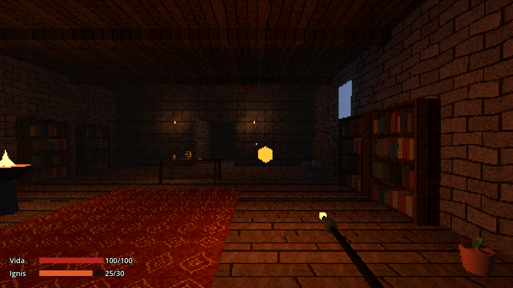

# Jogo do Mago

Roguelike dungeon crawler em 3D e primeira pessoa, com visual de PS1 e fantasia sombria. Você é um cientista mágico: escaneia tudo o que encontra para descobrir seus aspectos, estuda na escola de magia e desce à Dungeon por um portal. Ao morrer, volta à escola com o conhecimento intacto.

"Jogo do Mago" é o nome provisório; o nome escolhido para distribuir é *Catálogo do Abismo* (decisão 7).



## Estado

**M3: varinha e Focus de Fogo.** Além da escola e da pesquisa (M2): a varinha na mão direita lança bolas de fogo carregadas, que iluminam o caminho e gastam Ignis; o HUD mostra vida e reserva; o braseiro do Salão de Estudos recarrega a varinha.

| Documento | Conteúdo |
| --- | --- |
| [`docs/ESPECIFICACAO.md`](docs/ESPECIFICACAO.md) | especificação completa do projeto |
| [`docs/PROPOSTA-M0.md`](docs/PROPOSTA-M0.md) | tecnologia, arquitetura e decisões da seção 9 |
| [`DECISIONS.md`](DECISIONS.md) | registro de todas as decisões |
| [`docs/REFERENCIAS-VISUAIS.md`](docs/REFERENCIAS-VISUAIS.md) | direção de arte e paleta |
| [`CREDITS.md`](CREDITS.md) | ferramentas e recursos de terceiros |

## Como executar

1. Baixe o [Godot 4.7.2](https://godotengine.org/download/) (versão padrão, não a .NET). É um executável, sem instalação.
2. Abra o Godot, clique em **Importar** e escolha o arquivo `project.godot` desta pasta. Na primeira vez ele importa as texturas e os textos, o que leva alguns segundos.
3. Aperte **F5** para jogar.

Os executáveis prontos (Windows, Linux, macOS) entram no fim do recorte (M5).

## Controles

| Tecla | Ação |
| --- | --- |
| Clique | prende o mouse na janela e começa a jogar |
| W A S D ou setas | andar |
| Mouse | olhar |
| Botão esquerdo (segurar e soltar) | carregar e lançar a magia de fogo |
| Shift (segurar) | correr |
| Espaço | pular |
| E | interagir (por exemplo, estudar na Mesa de Pesquisa) |
| Botão direito (segurar) | escanear com a Lente Taxonômica |
| Tab | Livro de Pesquisa |
| Esc | pausa e opções; fecha qualquer tela |

## Como se joga (até aqui)

1. Você começa no **Salão de Estudos**. Mire um objeto (vela, jarro, vaso, pena, livro de registros, osso) e **segure o botão direito**: a Lente sobe e a barra enche em 1,5 s.
2. Cada **aspecto novo** rende 1 ponto de pesquisa. Escanear de novo não rende nada, mas mirar algo já escaneado mostra seus aspectos.
3. Na **Mesa de Pesquisa** (E), gaste 3 pontos para estudar **Compreensão de Ignis** (+20% de dano de fogo, usado a partir do M3).
4. O **Livro de Pesquisa** (Tab) lista aspectos, objetos escaneados e páginas estudadas.
5. **Magia de fogo:** segure o botão esquerdo por 0,6 s (a ponta da varinha acende e treme) e solte para lançar. Soltar antes cancela sem gastar nada. Cada disparo gasta 5 de Ignis; a varinha guarda 30. Com a página estudada, o dano sobe de 15 para 18.
6. A Lente e a varinha não funcionam ao mesmo tempo: ou você estuda, ou você ataca.
7. O **braseiro** (E) enche a reserva de Ignis. Fora da escola não há recarga.
8. O corredor ao norte leva à **Sala do Portal** (o portal funciona a partir do M4).

O conhecimento é gravado em `user://save.json` (JSON legível) a cada descoberta. Para começar do zero, apague esse arquivo.

## Opções gráficas

No menu de pausa, **Opções**:

- **Filtro visual:** *Crocante* (todos os efeitos, 240 linhas) ou *Limpo* (sem tremor, sem deformação, sem cor limitada, 480 linhas). Mexer em um efeito sozinho muda o filtro para *Personalizado*.
- **Resolução interna:** altura da imagem em que o mundo é desenhado antes de ser ampliado (180, 240, 360 ou 480 linhas).
- **Efeitos**, cada um com liga/desliga: vértices trêmulos (vertex snapping), texturas deformadas (mapeamento afim), névoa, cor limitada e dithering.
- **Sensibilidade do mouse.**

As opções ficam gravadas em `user://settings.cfg`. No Windows, a pasta `user://` é `%APPDATA%\Godot\app_userdata\Jogo do Mago`; no Linux, `~/.local/share/godot/app_userdata/Jogo do Mago`.

| Crocante | Limpo |
| --- | --- |
|  |  |

## Testes

A lógica do jogo (`scripts/core`) é testada com o [GUT](https://github.com/bitwes/Gut), sem abrir o jogo.

- **No editor:** painel **GUT**, na parte de baixo, botão **Run All**.
- **No terminal**, a partir desta pasta:

  ```sh
  godot --headless --path . --import            # só na primeira vez, ou depois de mudar arquivos fora do editor
  godot --headless --path . -s addons/gut/gut_cmdln.gd
  ```

  (`godot` é o caminho do executável do Godot.)

Os testes cobrem: custo, carga, intervalo e recarga da magia, eficiência da varinha, dano com páginas e fraquezas, vida, reinício da incursão, descoberta de aspectos e pontos de pesquisa, estudo de páginas, andamento do escaneamento, efeitos das páginas, persistência (save), o gerador com semente, as opções, o carregamento e a verificação dos dados e a regra de camadas (`scripts/core` não pode usar cena, entrada nem tela).

## Argumentos de desenvolvimento

Depois de `--` na linha de comando:

```sh
godot --path . -- --seed=123                  # semente do gerador aleatório (impressa ao abrir o jogo)
godot --path . -- --room=test_room            # sala inicial (school é o padrão; test_room é a sala do M1)
godot --path . -- --screenshot=captura.png    # tira uma captura depois de 30 quadros e fecha
```

## Como o projeto está organizado

```text
data/              conteúdo do jogo, um arquivo .tres por item (editável no inspetor)
  aspects/         aspectos (primais; compostos têm dois pais)
  scannables/      objetos escaneáveis e seus aspectos
  research/        regras de escaneamento e pontos (rules.tres) e páginas (pages/)
  player/          valores do jogador
  rooms/           salas: identificador, cena e atmosfera (névoa, luz ambiente)
  settings/        opções padrão e filtros visuais (presets/)
locales/           textos: ui.csv (interface), content.csv (conteúdo), names.csv (nomes de outras obras)
scenes/            cenas: main, player, salas (rooms/), objetos (props/) e interface (ui/)
scripts/
  core/            lógica pura, testável sem abrir o jogo (conhecimento, pesquisa, save, opções…)
  autoload/        globais: Content (dados), Settings (opções) e Game (conhecimento e save)
  game/            jogador, Lente, mundo, salas, objetos, blocos de greybox, luzes
  render/          shaders PS1 e a tela de baixa resolução
  ui/              HUD e menus
assets/            texturas e materiais
tests/unit/        testes do GUT
tools/             ferramentas (gerar as texturas provisórias)
addons/gut/        GUT, a ferramenta de testes
```

### Como o visual PS1 funciona

- O mundo 3D é desenhado num `SubViewport` pequeno (por exemplo, 427×240), e a `GameScreen` o amplia para a janela sem filtragem: os pixels ficam grandes e nítidos.
- `scripts/render/ps1.gdshader` é o material de todas as superfícies. Ele faz o **vertex snapping** (prende os vértices a uma grade de pixels), o **mapeamento afim** (interpola a textura sem correção de perspectiva) e a **névoa** por distância. A iluminação é calculada por vértice, como no PS1.
- `scripts/render/ps1_post.gdshader` reduz as cores a 5 bits por canal e aplica o **dithering** com uma matriz de Bayer 4×4.
- Os efeitos são ligados e desligados por parâmetros globais de shader (Projeto > Configurações do Projeto > Shader Globals), que o menu de opções altera.

### Montar uma sala no editor

1. Crie uma cena com um `Node3D` raiz e o script `scripts/game/room.gd`.
2. Adicione blocos: nó `StaticBody3D` com o script `scripts/game/greybox_block.gd`. No inspetor, ajuste `size` e escolha um material de `assets/materials/`. A malha e a colisão se ajustam sozinhas.
3. Adicione luzes (`OmniLight3D`; para tremular, use o script `scripts/game/flicker_light.gd`).
4. Adicione pelo menos um `Marker3D` com o script `scripts/game/entrance_point.gd` (`id = default`): é onde o jogador aparece, olhando para a seta azul.
5. Em `data/rooms/`, crie um recurso `RoomData` com o identificador, a cena e a atmosfera.

O guia completo para adicionar aspectos, Focus, inimigos e salas entra no M5.

### Texturas provisórias

As texturas de `assets/textures/` são geradas por código (`tools/generate_textures.gd`), com semente fixa. Para trocá-las por arte própria, substitua o PNG mantendo o nome. Em texturas novas, desative mipmaps e compressão na aba **Importar** (o padrão do projeto já faz isso).
